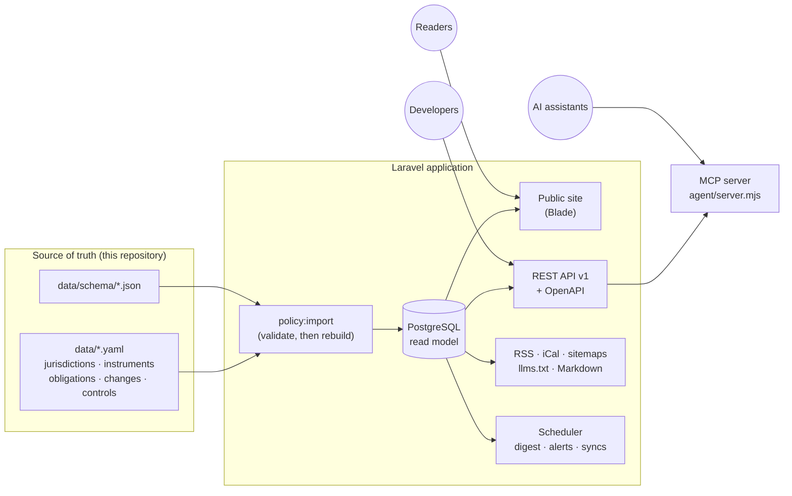

<!-- web -->
[homepage]: https://aipolicytracker.org
[policies]: https://aipolicytracker.org/policies
[obligations]: https://aipolicytracker.org/obligations
[updates]: https://aipolicytracker.org/updates
[opendata]: https://aipolicytracker.org/open-data
[openapi]: https://aipolicytracker.org/openapi.json
[llms]: https://aipolicytracker.org/llms.txt
[subscribe]: https://aipolicytracker.org/subscribe
[corrections]: https://aipolicytracker.org/corrections
[methodology]: https://aipolicytracker.org/methodology
[independence]: https://aipolicytracker.org/independence
[freshness]: https://aipolicytracker.org/freshness
[funding]: https://aipolicytracker.org/funding
<!-- github -->
[issues]: https://github.com/8h45k4r/aipolicytracker/issues/new?template=bug_report.yml
[correction]: https://github.com/8h45k4r/aipolicytracker/issues/new?template=policy_data_correction.yml
[features]: https://github.com/8h45k4r/aipolicytracker/issues/new?template=feature_request.yml
[newsource]: https://github.com/8h45k4r/aipolicytracker/issues/new?template=new_jurisdiction_or_source.yml
[advisory]: https://github.com/8h45k4r/aipolicytracker/security/advisories/new
<!-- repo docs -->
[devguide]: docs/developer-guide.md
[architecture]: docs/architecture.md
[docsindex]: docs/README.md
[contributing]: CONTRIBUTING.md
[security]: SECURITY.md
[agents]: AGENTS.md
<!-- badges -->
[ci-badge]: https://github.com/8h45k4r/aipolicytracker/actions/workflows/ci.yml/badge.svg
[ci]: https://github.com/8h45k4r/aipolicytracker/actions/workflows/ci.yml
[security-badge]: https://github.com/8h45k4r/aipolicytracker/actions/workflows/security.yml/badge.svg
[security-runs]: https://github.com/8h45k4r/aipolicytracker/actions/workflows/security.yml
[codeql-badge]: https://github.com/8h45k4r/aipolicytracker/actions/workflows/codeql.yml/badge.svg
[codeql]: https://github.com/8h45k4r/aipolicytracker/actions/workflows/codeql.yml
[data-badge]: https://github.com/8h45k4r/aipolicytracker/actions/workflows/validate-data.yml/badge.svg
[data-runs]: https://github.com/8h45k4r/aipolicytracker/actions/workflows/validate-data.yml
[code-licence]: https://img.shields.io/badge/code-Apache--2.0-blue?style=flat-square
[data-licence]: https://img.shields.io/badge/data-CC%20BY%204.0-blue?style=flat-square
[release]: https://img.shields.io/github/v/release/8h45k4r/aipolicytracker?style=flat-square&label=release
[stars]: https://img.shields.io/github/stars/8h45k4r/aipolicytracker?style=flat-square
[commit]: https://img.shields.io/github/last-commit/8h45k4r/aipolicytracker?style=flat-square

<div align="center">

<a href="https://aipolicytracker.org">
  <picture>
    <source media="(prefers-color-scheme: dark)" srcset="public/brand/logo-on-dark.svg">
    
  </picture>
</a>

[![CI][ci-badge]][ci]
[![Security][security-badge]][security-runs]
[![CodeQL][codeql-badge]][codeql]
[![Validate policy data][data-badge]][data-runs]
<br>
[![Code licence][code-licence]](LICENSE)
[![Data licence][data-licence]](data/LICENSE)
[![Release][release]](https://github.com/8h45k4r/aipolicytracker/releases)
[![Last commit][commit]](https://github.com/8h45k4r/aipolicytracker/commits/main)
[![Stars][stars]](https://github.com/8h45k4r/aipolicytracker/stargazers)

### The open, source-backed record of the world's AI laws and the duties they create

_Every record links its official source, says whether a named person has checked it, and has a permanent id you can cite._

[__Open the tracker »__][homepage]
<br>
[Open data & API][opendata] ·
[Report a correction][correction] ·
[Report a bug][issues] ·
[Request a feature][features] ·
[Developer guide][devguide] ·
[Architecture][architecture]

</div>

<details open="open">
<summary>Contents</summary>
<ol>
<li><a href="#about-the-project">About the project</a></li>
<li><a href="#whats-in-the-record">What's in the record</a></li>
<li><a href="#using-the-data">Using the data</a></li>
<li><a href="#mcp-server-for-ai-agents">MCP server for AI agents</a></li>
<li><a href="#running-it-locally">Running it locally</a></li>
<li><a href="#project-structure">Project structure</a></li>
<li><a href="#frequently-asked-questions">Frequently asked questions</a></li>
<li><a href="#contributing">Contributing</a></li>
<li><a href="#security">Security</a></li>
<li><a href="#citing">Citing</a></li>
<li><a href="#licence">Licence</a></li>
<li><a href="#who-runs-it">Who runs it</a></li>
<li><a href="#acknowledgements">Acknowledgements</a></li>
</ol>
</details>

## About the project

[__AIPolicyTracker__][homepage] is an open tracker of AI laws, policies and the duties they create.

It covers 249 jurisdictions: 197 countries, including every UN member state, 5 supranational bodies, 31 states
and provinces, 14 regions and cities, and 2 territories. It pays extra attention to the regions most trackers
skip: South Asia, South-East Asia, Africa and Latin America. Laws are broken down into obligations, the
obligations are linked to controls and evidence, and the whole dataset can be browsed, downloaded, queried
through an API or read by AI agents.

> [!IMPORTANT]
> Nothing here is legal advice. Check the official source before you rely on a record. Each record says whether
> a person has checked it against that source, and [how fast changes reach the record][freshness] is measured in public.

### How it works

The records are plain YAML files in [`data/`](data), one per jurisdiction, instrument and control, each checked
against a JSON Schema. Every deploy validates them and rebuilds the database from them, so a correction is a
reviewable diff with its source attached. The site, the API, the feeds, the alerts and the MCP server all read
that one database.

<details>
<summary><b>Architecture at a glance</b></summary>
<br>



The full design, components and decisions are in [`docs/architecture.md`][architecture].

</details>

## What's in the record

| | Today | Where |
|---|---|---|
| Jurisdictions | 249 | [`data/jurisdictions/`](data/jurisdictions) |
| Laws, regulations, strategies and guidance | 244, of which 184 are verified by a named reviewer | [`data/policies/`](data/policies) |
| Obligations broken out of those instruments | 117, each citing its article or section | inside each instrument file |
| Dated changes | 154 | [`data/changes/`](data/changes) |
| Controls that meet the obligations | 26, each with the evidence it produces and references to standards such as ISO/IEC 42001 and the NIST AI RMF | [`data/controls/`](data/controls) |

Every policy, obligation, change and control has a permanent id (`AIPT-POL-0073`) that never changes or gets
reused. `https://aipolicytracker.org/id/{id}` always resolves it, wherever the record lives.

The site also carries the AI Incident Database and the MIT AI Risk Repository, linked to the laws on record that
address each harm, plus an enforcement tracker, an AI economic transition tracker and a templates library
generated from the records.

## Using the data

<details open>
<summary><b>Browse and follow</b></summary>

- [Laws and policies][policies], [obligations][obligations] and [what changed][updates]
- A [weekly digest][subscribe], RSS feeds per jurisdiction, and calendar feeds of application dates
- Every record has a "Report a correction" link; [`/corrections`][corrections] shows what happened to each report

</details>

<details>
<summary><b>Download</b></summary>

- CSV and NDJSON for jurisdictions, policies, obligations, controls, changes and deadlines, plus a full JSON
  export, from the [open data page][opendata]
- Each record as JSON (`/policies/{slug}.json`) or as a Markdown context file with a provenance block
  (`/policies/{slug}.md`)

</details>

<details>
<summary><b>Query the API</b></summary>

A read-only REST API under `/api/v1`, described by an [OpenAPI document][openapi]:

```bash
curl -s "https://aipolicytracker.org/api/v1/policies?jurisdiction=eu&per_page=5"
curl -s "https://aipolicytracker.org/api/v1/obligations?category=transparency"
curl -s "https://aipolicytracker.org/api/v1/changes?since=2026-01-01"
```

Endpoints cover jurisdictions, policies, obligations, controls, changes, deadlines (including which dates apply
to one organisation), frameworks and crosswalks, incidents, risks, the transition tracker, enforcement,
implementation measures and templates.

</details>

<details>
<summary><b>For AI assistants and search</b></summary>

- [`/llms.txt`][llms] and `/llms-full.txt` describe the corpus, its caveats and how to cite it
- The [MCP server](#mcp-server-for-ai-agents) below lets an assistant look records up instead of scraping pages

</details>

The data is CC BY 4.0. Credit "AIPolicyTracker", link to the record you used, and cite its permanent id.

## MCP server for AI agents

[`agent/server.mjs`](agent) is a read-only [Model Context Protocol](https://modelcontextprotocol.io) server with no
dependencies. It speaks JSON-RPC over stdio and calls the same public URLs a browser would, so an assistant can
search policies, resolve permanent ids, read obligations, check which deadlines apply, and see how far the corpus
can be trusted before it quotes a record.

<details>
<summary><b>Add it to an MCP client</b></summary>

```json
{
  "mcpServers": {
    "aipolicytracker": {
      "command": "node",
      "args": ["/path/to/aipolicytracker/agent/server.mjs"]
    }
  }
}
```

Set `AIPOLICYTRACKER_BASE_URL` to point it at a local instance. The full tool list is in
[`agent/README.md`](agent/README.md).

</details>

## Running it locally

You need PHP 8.3+ with the `pdo_sqlite`, `mbstring`, `intl`, `gd`, `zip`, `xml`, `fileinfo`, `iconv` and
`bcmath` extensions (`composer check-platform-reqs` lists anything missing), Composer 2, and Node (the version in
[`.nvmrc`](.nvmrc)). Nothing needs a network connection or an API key: the external datasets are committed, and
the built front end is in `public/build`.

```bash
git clone https://github.com/8h45k4r/aipolicytracker.git && cd aipolicytracker
composer install
cp .env.example .env && php artisan key:generate
touch database/database.sqlite
php artisan migrate --seed
php artisan policy:import      # build the database from data/
php artisan external:import    # AI incidents and the MIT risk repository
php artisan serve              # then open http://127.0.0.1:8000
```

<details>
<summary><b>Front end, tests and checks</b></summary>

Only to change the front end (`resources/js`, `resources/css`): run `npm ci` once and `npm run dev` in a second
terminal. Without them the site uses the committed build in `public/build`.

Before you open a pull request:

```bash
composer lint                   # Laravel Pint
composer test                   # the PHP suite (SQLite)
npm run lint && npm run build   # ESLint, then rebuild public/build if the front end changed
php artisan policy:validate     # the data files against their schemas and cross-references
```

</details>

<details>
<summary><b>Docker</b></summary>

The production image is built from the [`Dockerfile`](Dockerfile) and run with Docker Compose. See
[`deploy/README-docker.md`](deploy/README-docker.md) for the compose setup, the scheduler, backups and automatic
deploys.

</details>

The [developer guide][devguide] covers everything else: the test suites, artisan commands, CI and releases.

## Project structure

```text
data/            the records (YAML) and their JSON Schemas: the source of truth
app/             Laravel application: importers, services, controllers, console commands
resources/       Blade views, CSS and the React account screens
routes/          public site, API, admin and console routes (the scheduler is in routes/console.php)
database/        migrations and seeders
agent/           the MCP server
tests/           feature and unit tests (PHP), and tests/js for the front end
deploy/, docker/ the Docker image, compose files and runbooks
docs/            developer guide, architecture, modules, operations, reference and archive
```

The [documentation index][docsindex] lists every guide.

## Frequently asked questions

<details>
<summary><b>What is AIPolicyTracker?</b></summary>

An open, source-backed tracker of AI laws, regulations, strategies and guidance in 249 jurisdictions. It breaks
laws down into the obligations they create, links each obligation to the article it comes from, and records dated
changes, deadlines and the controls that meet the obligations.

</details>

<details>
<summary><b>Is it free, and can I reuse the data?</b></summary>

Yes. The site, the API and the downloads are free. The data is CC BY 4.0: reuse it for any purpose, including
commercial use, if you credit "AIPolicyTracker" and link the record. The code is Apache 2.0.

</details>

<details>
<summary><b>How do I know a record is accurate?</b></summary>

Every record links its official source and says whether a named reviewer has checked it against that source, and
when. Records not yet checked say so. Mistakes and their fixes are public on the [corrections log][corrections], and
the [methodology][methodology] explains how records are made and verified. Nothing here is legal advice.

</details>

<details>
<summary><b>Does it cover the EU AI Act?</b></summary>

Yes, with its obligations broken out article by article, its application dates (including later amendments), the
implementation measures it depends on, and the standards behind it.

</details>

<details>
<summary><b>Can an AI assistant use it?</b></summary>

Yes. Point an MCP client at the [MCP server](#mcp-server-for-ai-agents), or read [`/llms.txt`][llms] and the
Markdown version of any record. Both carry the record's provenance, so an answer can cite its source.

</details>

<details>
<summary><b>How do I report a mistake or suggest a law?</b></summary>

Use "Report a correction" on the record's page, [open a correction issue][correction], or
[suggest a new law or jurisdiction][newsource] with its official source.

</details>

## Contributing

Data corrections are the most useful contribution, and each needs an official source.

- **A record is wrong or out of date:** use "Report a correction" on the record's page, or [open a correction][correction]
- **A law or jurisdiction is missing:** [suggest it with its official source][newsource]
- **Code:** read [`CONTRIBUTING.md`][contributing] and the [developer guide][devguide], then open a pull request
  using the template. AI coding agents should read [`AGENTS.md`][agents] first.

[`SOURCE_ATTRIBUTION.md`](SOURCE_ATTRIBUTION.md) lists which sources count, and
[`GOVERNANCE.md`](GOVERNANCE.md) explains how decisions are made. Everyone taking part follows the
[Code of Conduct](CODE_OF_CONDUCT.md).

## Security

Please do not open a public issue for a security problem. Report it privately through
[GitHub's advisory form][advisory] or by email, as described in [`SECURITY.md`][security].

## Citing

Cite a record by its title, permanent id, record version and verification, as each page's "Cite this record"
block gives it:

```text
AIPolicyTracker (2026). "<title>" [AIPT-POL-0073, record version <n>, verified <date> by <reviewer>].
https://aipolicytracker.org/id/AIPT-POL-0073 (accessed <date>).
```

To cite the dataset as a whole, use [`CITATION.cff`](CITATION.cff); GitHub's "Cite this repository" button reads it.

## Licence

- **Code:** [Apache 2.0](LICENSE)
- **Data:** [CC BY 4.0](data/LICENSE)
- **Third-party data** keeps its own licence: incidents from the AI Incident Database (CC BY-SA 4.0) and the risk
  taxonomy from the MIT AI Risk Repository (CC BY 4.0). See [`NOTICE`](NOTICE) and [`third_party/`](third_party).

## Who runs it

AIPolicyTracker is built and maintained by [Bhaskar Bhatt](https://bhaskar.com.np/). Contact
[bhaskar@aipolicytracker.org](mailto:bhaskar@aipolicytracker.org).

**Independent data reviewer:** Joyce Loksee Ho reviews data changes for accuracy against official
sources. Her appointment, roster entry and declaration of interest are being set up; see
[`GOVERNANCE.md`](GOVERNANCE.md) for the current status.

[How the project is funded][funding] is public, including its rules on independence. The maintainer is also
associated with Certifyi, a commercial compliance product. That product has no editorial say over what the
records contain; [`CONFLICT_OF_INTEREST.md`](CONFLICT_OF_INTEREST.md) sets out the binding rules and
[`/independence`][independence] explains the relationship and what is not yet independent.

## Acknowledgements

The tracker stands on public work by others:

- The official sources of every government, regulator and legislature it records
- The [AI Incident Database](https://incidentdatabase.ai/) (Responsible AI Collaborative)
- The [MIT AI Risk Repository](https://airisk.mit.edu/)
- [Laravel](https://laravel.com/), [Inertia](https://inertiajs.com/), [React](https://react.dev/),
  [Tailwind CSS](https://tailwindcss.com/) and [Vite](https://vite.dev/)
- [amCharts](https://www.amcharts.com/) for the world map

If the tracker is useful to you, a star on the repository helps others find it.
