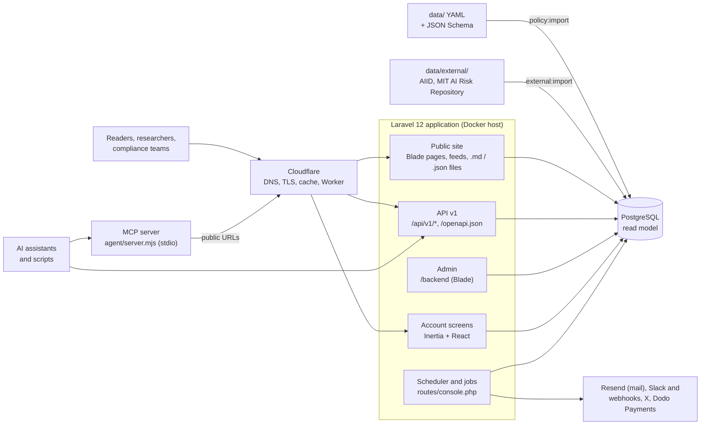
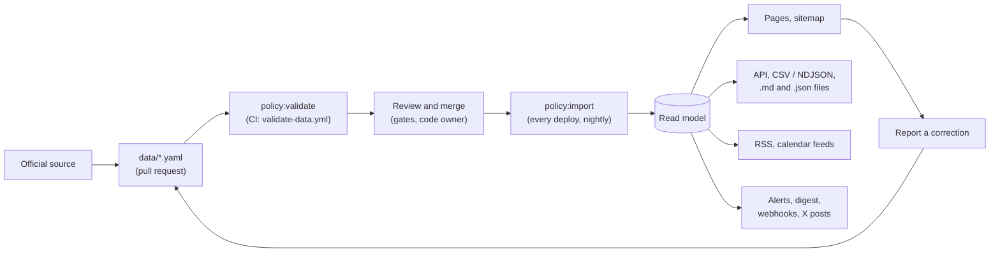

# Architecture

A high-level view of how AIPolicyTracker is put together. Each part has its own page in
[`docs/modules/`](modules/README.md) with the tables, routes and open debt; this page shows how the
parts fit.

## Context

- **Source of truth.** Records are YAML files in `data/`, one per jurisdiction, policy and control,
  each checked against a JSON Schema in `data/schema/`. The database is a read model rebuilt from
  them.
- **Hosting.** Production is a Docker host: nginx on the host in front of the app container and a
  PostgreSQL container ([`deploy/README-docker.md`](../deploy/README-docker.md)). Cloudflare sits in
  front of nginx ([`cloudflare/README.md`](../cloudflare/README.md)).
- **External data.** The AI Incident Database and the MIT AI Risk Repository are committed as JSON
  under `data/external/`. A weekly workflow refreshes them by pull request; nothing writes to
  production directly.
- **Agents** reach the data through the MCP server in `agent/`, which calls the same public URLs a
  browser would, or directly through the API, `llms.txt` and the Markdown context files.

The older drawing in [`diagrams/architecture.svg`](diagrams/architecture.svg) shows the same
picture with the edge, mail and readers spelled out.

## How a record flows

1. A contributor edits a YAML record with its official source ([`data/README.md`](../data/README.md)).
2. `php artisan policy:validate` checks schema, enums, URLs, dates and cross-references
   (`App\Services\PolicyData\PolicyDataValidator`). CI runs it on every pull request that touches
   `data/`, together with the freshness and coverage checks.
3. A published reviewer verifies the record against its source and the pull request merges.
4. `php artisan policy:import` validates again, then upserts every record. The container runs it in
   the background on every start (`docker/entrypoint.sh`), and the scheduler runs it nightly.
5. The read model serves the pages, the API and exports, the feeds, and the daily alerts and weekly
   digest. Reader corrections go to the admin review queue and come back as YAML changes.

[`diagrams/data-flow.svg`](diagrams/data-flow.svg) draws the same path. The day-to-day procedure is in
[`operations/data-updates.md`](operations/data-updates.md).

## Components

| Component | What it is | Where it lives | Module doc |
|-----------|-----------|----------------|------------|
| Public site | Server-rendered Blade pages with Tailwind, feeds, sitemaps, Markdown and JSON record files | `resources/views/site/`, `routes/public.php`, `app/Http/Controllers/Site/` | [policy-intelligence](modules/policy-intelligence.md) |
| Admin | Blade back office: review queue, change desk, users, settings, jobs | `resources/views/backend/`, `routes/backend/web.php`, `app/Http/Controllers/Backend/` | [accounts](modules/accounts.md) |
| Account screens | Sign-in and profile, React with Inertia | `resources/js/Pages/`, `routes/auth.php` | [accounts](modules/accounts.md) |
| API v1 | Read-only JSON API, throttled at 120 requests a minute, described by `/openapi.json` | `routes/api.php`, `app/Http/Controllers/Api/V1/` | [machine-readable surfaces](reference/machine-readable-surfaces.md) |
| MCP server | Dependency-free JSON-RPC server over stdio that calls the public site | `agent/` | [`agent/README.md`](../agent/README.md) |
| Data import | Validator, importer and repository for `data/` | `app/Services/PolicyData/`, `app/Console/Commands/` | [policy-intelligence](modules/policy-intelligence.md) |
| External data | AIID and MIT risk files, imported into read-model tables | `data/external/`, `app/Services/ExternalData/` | [external-data](modules/external-data.md) |
| Scheduler and jobs | One catalogue of recurring work (`JobRun::JOBS`), run by `schedule:work` in the container | `routes/console.php`, `app/Models/JobRun.php` | [jobs](modules/jobs.md) |
| Change desk | Source re-check queue, record history, permanent ids | `app/Services/ChangeDesk/`, `config/changedesk.php` | [change-desk-and-provenance](modules/change-desk-and-provenance.md) |
| Alerts and webhooks | Daily alerts for followed records, delivered by e-mail, Slack and webhooks | `app/Services/Alerts/` | [alerts](modules/alerts.md) |
| Posting to X | Posts each new verified change with a preview card | `app/Services/Social/` | [social-posting](modules/social-posting.md) |
| Billing | Pro plans through Dodo Payments; checkout is off by default | `app/Services/Billing/` | [billing](modules/billing.md) |

## Key design decisions

**`data/` is the source of truth.** Every fact is a YAML line in a reviewable diff, with its official
source beside it. Policy records in the database are rebuilt from `data/` on every import;
accounts, subscribers, submissions, billing records and the audit log are not. `policy:import`
refuses invalid data.
Where: `data/`, `data/schema/`, `app/Services/PolicyData/`.

**Permanent ids.** Every policy, obligation, change and control has an `aipt_id`
(`AIPT-POL-0001`, `AIPT-OBL-…`, `AIPT-CHG-…`, `AIPT-CTL-…`), assigned once and never changed or
reused. `/id/{id}` redirects to the record wherever it lives now, so a citation survives a slug
rename. Where: `PolicyDataValidator`, `php artisan policy:next-id`,
[change-desk-and-provenance](modules/change-desk-and-provenance.md).

**Verification states.** A record is `draft`, `pending_review`, `verified` or `needs_update`
(`data/schema/common.schema.json`). `verified` needs `last_verified_at` and a `reviewed_by` who is on
the published roster in `data/reviewers/`; `last_verified_at` without `verified` is rejected. Only a
person who opened the source sets the date. The verification policy decides when a record is overdue
for a re-check. Where: `PolicyDataValidator::checkVerification()`,
`app/Services/Verification/`, [verification-policy](reference/verification-policy.md).

**Stateless public files.** Feeds, sitemaps, `llms.txt`, `openapi.json` and the `.md` and `.json`
record files run without the session, cookie and CSRF middleware. A crawler polling them writes no
session row, and the CDN may cache them. Where: the `$stateless` list in `routes/public.php`.

**SSRF guard on outbound calls.** A webhook address a user supplies is refused when it names or
resolves to a loopback, private, link-local, shared or reserved address. The resolved address is
pinned, so DNS cannot change between the check and the connection. Where: `app/Support/OutboundUrl.php`,
used by `AlertChannelController` (at save time) and `WebhookDispatcher` (at send time).

**Config must be cacheable.** The container runs `config:cache` on every start, so nothing in
`config/` may hold a closure. Rules that need closures live in `app/`
(`VerificationRuleset`, `CompletenessChecks`). Where: `tests/Feature/ConfigIsCacheableTest.php`.

**Security headers in the app.** A nonce-based Content-Security-Policy and the other headers are set
by `App\Http\Middleware\SecurityHeaders`, not by the proxy. See [`SECURITY.md`](../SECURITY.md).

## Further reading

- [`docs/modules/`](modules/README.md): one page per module, with field tables that match the migrations.
- [`docs/reference/engineering-standard.md`](reference/engineering-standard.md) and
  [`change-gates.md`](reference/change-gates.md): how a change is made and what it must prove.
- [`docs/reference/technical-debt.md`](reference/technical-debt.md): the known gaps.
